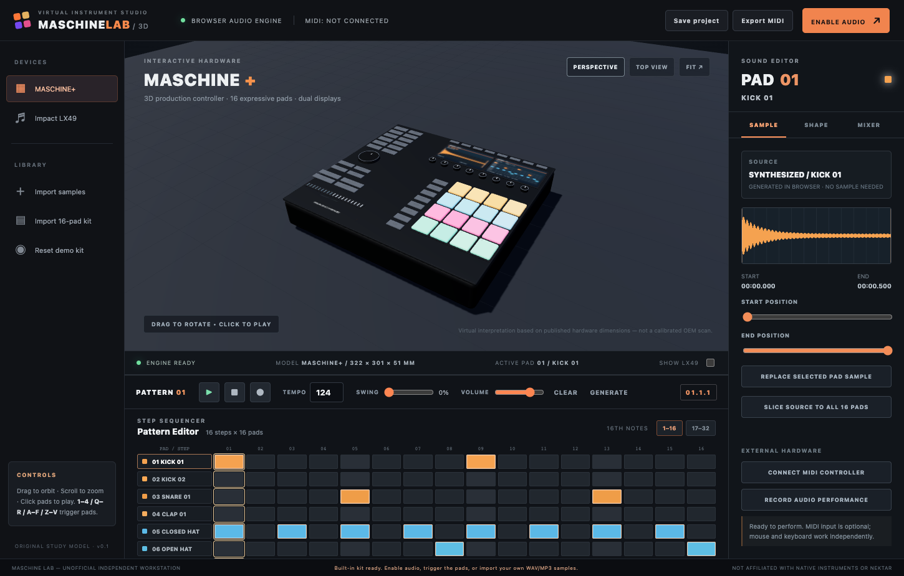

# MASCHINE LAB 3D — browser sampler workstation

An **independent, locally runnable browser-based 3D sampler** from the MASCHINE LAB project. This is the actual original 3D application source, not an approximate screenshot of another sampler. It was developed separately from the installed **MASCHINE LAB 2D** native macOS/AU/VST3 application. No commercial audio samples, purchased sound packs, local projects, or native binaries are included.

## Run

From this folder, run `python3 -m http.server 11988 --bind 127.0.0.1`, then visit `http://127.0.0.1:11988/` in Chrome. The Three.js-based controller and built-in demo synthesis run locally. Browser audio requires a user gesture; Web MIDI requires browser and controller permission.

## Features in the included source

- Rotatable, zoomable modeled sampler surface with sixteen responsive pads, dual-screen artwork, encoders, buttons, and touch-style control.
- Optional modeled 49-key controller, toggled with **SHOW LX49**.
- Built-in *synthesized* demo kit, sample import from user-owned local files, a thirty-two-step pattern, tempo/swing controls, and browser sample slicing.
- Browser MIDI input, project metadata JSON export, pattern MIDI export and optional audio recording subject to browser support.

The control geometry is an original study based on published product dimensions, **not official Native Instruments CAD, firmware, sound bank, or hardware certification**. Some buttons are demo mappings. The browser source does not bundle or reproduce the separate native 2D program's private song workspaces.

## Third-party attribution

The `vendor/` directory contains code from [three.js](https://github.com/mrdoob/three.js), Copyright (c) 2010–2025 three.js authors, under the **MIT License**, including its `OrbitControls`, `RoundedBoxGeometry` and core modules. See [THREE-LICENSE.md](THREE-LICENSE.md). The remaining workstation model and interface source are part of this project. Product names indicate hardware references only, not vendor affiliation.

The [main Sampler Projects README](../README.md) also shows the genuinely installed native MASCHINE LAB 2D sampler, with personal audio/session text removed from its screenshot. That native program requires separate JUCE sources and a Mac build and is **not included as a runnable native binary** in this browser source folder.

## Screenshot verification (2026-11-14)

The screenshots in the parent README were freshly recaptured from this exact source tree with headless Google Chrome: HTTP 200, 16 responsive pad objects, Three.js canvas present, optional LX49 keyboard successfully toggled, and zero browser JavaScript exceptions. This is browser/UI verification, **not a hardware MIDI or real-audio latency test**.
