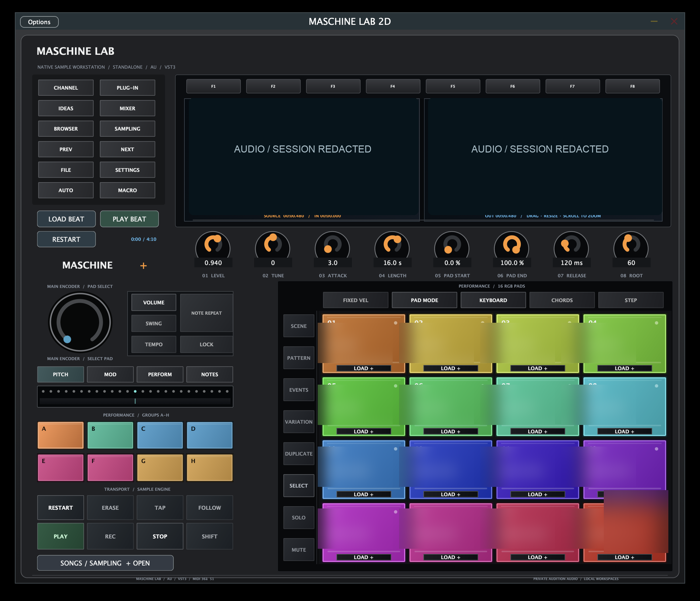
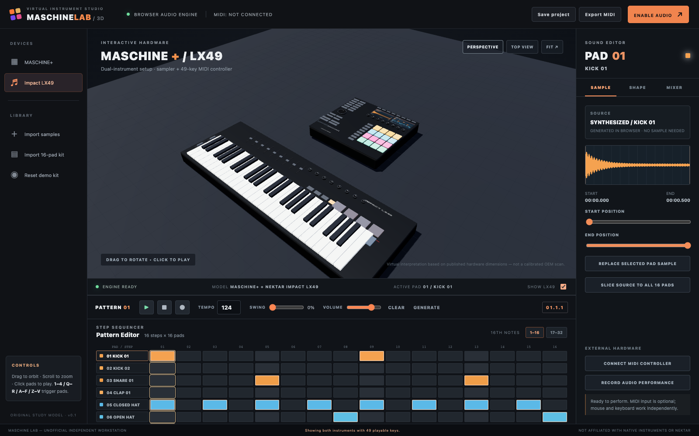
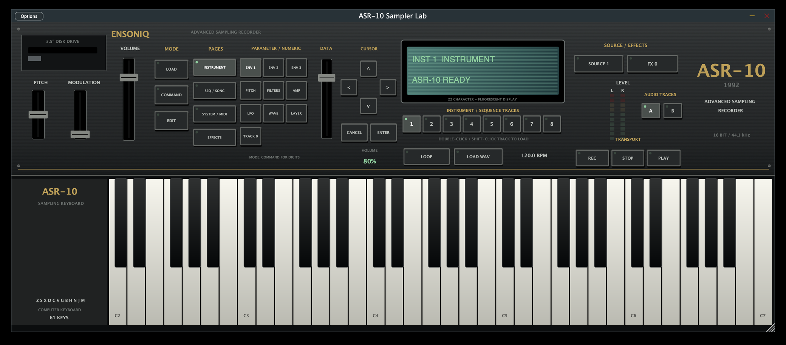

# Sampler Projects

A collection of source experiments for music sampling, slicing, sequencing and plugin development. No audio samples or finished plugin binaries are bundled; bring recordings that you own or are licensed to use.

## Projects and architecture

| Folder | Technology | Scope |
| --- | --- | --- |
| [`CHOPROOM/`](CHOPROOM/) | Browser HTML, CSS and JavaScript; optional Python device bridge | Source audio editor, slicing markers, pad banks, arrangements, local session tools and export logic. |
| [`MaschineLab3D/`](MaschineLab3D/) | Three.js, Web Audio and Web MIDI | Original interactive 3D MASCHINE LAB workstation, modeled 16-pad controller, step sequencer, optional keyboard and synthetic demo instruments. |
| [`NativeSampler/`](NativeSampler/) | JUCE 8, CMake, C++ | Native sampler engine, plugin interface, effects, MIDI/FLX4 bridge experiments and engine tests. |
| [`ASR10Sampler/`](ASR10Sampler/) | JUCE 8, CMake, C++ | ASR-style instrument/plugin experiments including settings and bank/clip test suites. |
| [`VintageSamplerLab/`](VintageSamplerLab/) | Python | Legacy sampler, pad sequencer, keyzones and UI experiments. |

Each component is independent. There is no unified installer or evidence that all source trees reproduce locally installed applications.

**MASCHINE LAB 2D is also part of the project's history:** the independently installed macOS standalone/AU/VST3 sampler has a 16-RGB-pad performance board and two waveform screens. See its *real native UI screenshot* in the gallery below. Its current installed program contains private, hardcoded song-library integrations, so this public snapshot does not redistribute the native 2D binary or claim its complete source is reproducible from the included 3D browser files.

## Run the browser editor

```sh
cd CHOPROOM
python3 -m http.server 8080
# http://127.0.0.1:8080/
```

Choose your own browser-supported audio; the source release has no demonstration songs. See [CHOPROOM's README](CHOPROOM/README.md) for details about slicing, arrangements and export limitations.

**To run the different MASCHINE LAB 3D browser emulator**, `cd MaschineLab3D && python3 -m http.server 11988 --bind 127.0.0.1`, then open `http://127.0.0.1:11988/`. This one has synthesized demo sounds but no distributed recorded audio. See [its own README](MaschineLab3D/README.md).

## Build native projects

JUCE 8 must be available separately along with CMake and a compatible C++/platform audio toolchain. Set `JUCE_ROOT` to your own JUCE source checkout:

```sh
cmake -S NativeSampler -B /tmp/native-sampler-build -DJUCE_ROOT=/path/to/JUCE
cmake --build /tmp/native-sampler-build
cmake -S ASR10Sampler -B /tmp/asr10-sampler-build -DJUCE_ROOT=/path/to/JUCE
cmake --build /tmp/asr10-sampler-build
```

Native plugin/AU/VST and real host tests need the target DAW, audio devices and platform SDKs. Project-specific requirements are in the subfolder READMEs and CMake files.

## Tests

```sh
python3 -m unittest discover -s VintageSamplerLab -p 'test_*.py'
cd CHOPROOM
node test_slicing.js
node test_arranger.js
node test_export.js
node test_marker_controls.js
node test_track_view.js
node test_chop_variants.js
node test_chop_collection.js
```

See [STATUS.md](STATUS.md) for the audited test outcomes. Native C++ builds have not been verified in this source-only staging environment.

## Release scope

No personal recordings, copyrighted music, sample libraries, audio stems, artwork with uncertain redistribution rights, cached render files, or compiled apps are included. Some optional features that depended on a particular local file layout have been omitted. Users must supply legally usable audio and their own environment configuration.

See [third-party notices](THIRD_PARTY_NOTICES.md) for dependencies and attribution.

## UI preview

### MASCHINE LAB, the missing native and 3D sampling workstations

**Native MASCHINE LAB 2D, authentic installed Mac app captured November 14, 2026.** It is distinct from the Vintage and ASR sampler projects. The selected private audio waveform, sample names and session data have been visibly redacted while retaining the actual dual-display, knob, transport, and 16-pad layout. No screenshot implies that this public 3D source reproduces the native app.



**Original 3D MASCHINE LAB browser application (source included here):** The source-owned 3D controller model and its optional LX49-style keyboard were captured in actual Chrome sessions with synthetic demo sounds, not user tracks.

| 3D modeled sampler | 3D sampler with optional modeled keyboard |
| --- | --- |
|  |  |

The 3D browser source is under [`MaschineLab3D/`](MaschineLab3D/). It uses locally vendored MIT-licensed Three.js; no OEM firmware, licensed manufacturer photos, or private bank audio are included. The native JUCE 2D app still requires private-song-agnostic source cleanup and a reproducible native build before it can be described as a complete public source release.


*Actual browser capture of the staged CHOPROOM empty state, 2026-11-14. No demo audio, user samples or hardware are present. This image confirms the UI renders, not that browser audio export or external devices have passed integration testing.*

### CHOPROOM editor and pad workspace


Both additional images are actual November 14, 2026 headless Chrome screenshots of the staged `CHOPROOM/index.html` running without loaded audio. The 16-pad bank and slicing panels are visible in their empty state. These do not demonstrate successful audio rendering, device communication or export.

### Native sampler, ASR and vintage interfaces

`NativeSampler` and `ASR10Sampler` contain JUCE/C++ editor sources; `VintageSamplerLab` contains Python UI source. These additional UI references come from their local development history, **not** a new clean build from this published checkout. They help reviewers see the intended sampling interfaces without downloading private audio.

**Vintage Sampler Lab: actual running native app screenshot, November 14, 2026.** The 16 RGB pads, sample/edit controls and mixer are visible. Sample filenames, waveforms and pad content were deliberately redacted; the modified screenshot is not presented as an unedited capture.


**ASR-10 Sampler Lab: historic source-project UI capture from November 2026**, showing the interface, LCD, transport and playable-style keyboard in an unloaded/default state. This is a screenshot of the emulator UI, not a verified connected sampler, physical hardware or a clean native rebuild from this release.



**Vintage board concept artwork:** separately labeled illustration from the original project assets, not an application screenshot or evidence of a working plugin.


See [screenshot provenance and privacy notes](docs/screenshots/README.md). Native plugin compilation, DAW hosting and hardware audio routing remain independent verification steps.
